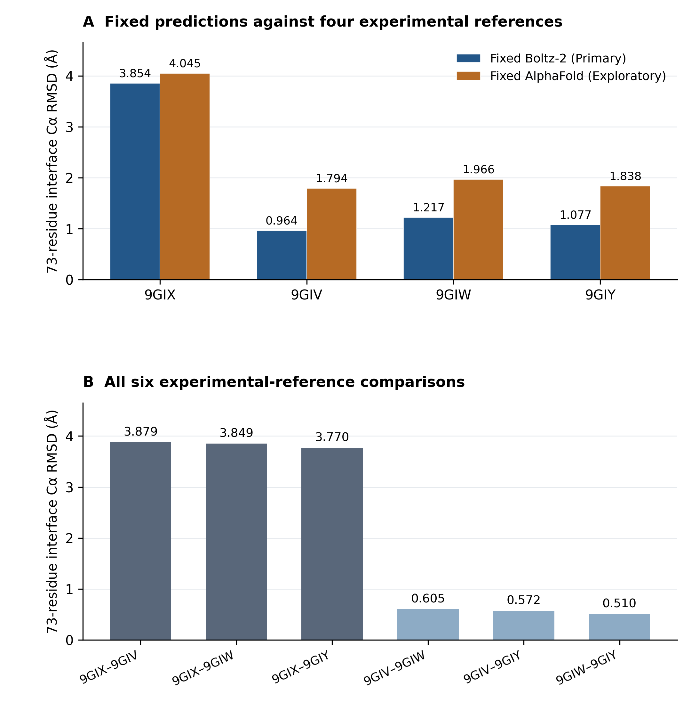

# Experimental-Reference Sensitivity of a Fixed Boltz-2 MPC1L–MPC2 Complex Prediction, with an Exploratory AlphaFold Structural Comparison

**Technical Note · v1.0.0 · 3 November 2026**  
**Sho Miyazaki** · Independent researcher, Tokyo, Japan  
Repository name: `boltz2-mpc-reference-structure-comparison`  
**Zenodo version DOI: [10.5281/zenodo.23910491](https://doi.org/10.5281/zenodo.23910491).** Repository: [https://github.com/shomiyazaki-ai/boltz2-mpc-reference-structure-comparison](https://github.com/shomiyazaki-ai/boltz2-mpc-reference-structure-comparison). The version 1.0.0 payload is identified by the distribution checksums; GitHub release commit and tag details are recorded separately after fixation.

## At a glance

One fixed Boltz-2 v2.1.1 Human PPI Atlas structure (Primary A) and one independently sourced fixed AFDB/NVIDIA AlphaFold-derived structure (Exploratory B) were compared with four experimental MPC1L–MPC2 complexes. A single experimentally defined 73-residue interface Cα mask and proper two-chain fit were held constant.

| Experimental reference | Condition / published state | Fixed Boltz-2 RMSD (Å) | Fixed AlphaFold RMSD (Å) |
| --- | --- | ---: | ---: |
| 9GIX | Apo / inward-open | 3.853976 | 4.045460 |
| 9GIV | C7 / outward-open | 0.964115 | 1.794373 |
| 9GIW | Zaprinast / outward-open | 1.217374 | 1.966428 |
| 9GIY | Mitoglitazone / outward-open | 1.077057 | 1.837599 |

For the selected Boltz coordinates, agreement was reference-dependent: RMSD was lower to each of the three inhibitor-bound outward-open references than to apo inward-open 9GIX. The exploratory fixed AlphaFold structure showed the same qualitative ordering. These are selected-coordinate observations, not a general model ranking.



## Research question and scope

**Primary:** How does structural agreement between one fixed Boltz-2 MPC1L–MPC2 prediction and four experimental complex structures vary under a common, experimentally defined interface Cα alignment protocol?

**Supporting:** predefined 62/198-site and chain-fit sensitivities; all six experimental-reference comparisons; DockQ, FreeSASA, H1/H2/H3 proxies, five local pairs per structure, Tier 0/1/2 interaction candidates and experimental local-quality context.

**Exploratory:** whether a second independently sourced fixed AlphaFold-derived structure shows a similar reference-dependent pattern under the same protocol. Neither prediction is regenerated here. CPU-inference and diagnostic/safety work (C+D) is a separate output and is not part of this release.

## Principal findings

- Boltz's 73-site RMSD was 3.853976 Å to 9GIX versus 0.964115–1.217374 Å to the three outward-open references. All six experimental-reference values appear in main Table 2 and Figure 1B.
- The 9GIX contrast includes MPC2 own-fit RMSD of 4.172290 Å and fit-MPC1L/evaluate-MPC2 RMSD of 8.303083 Å. Cross-chain RMSD combines internal geometry with relative arrangement; it is not a pure chain translation.
- Boltz H1 local-axis correspondence differed by protein: MPC1L was closer to the 9GIX proxy, while MPC2 was closer to the outward-open proxies. No mixed transport state is assigned. The 9GIX MPC2 sensitivity flag is retained.
- All distinct Tier 0 salt-bridge candidate pairs are MPC1L Glu51–MPC2 Lys66 (9GIV, 9GIW, 9GIY) and MPC1L Arg56–MPC2 Asp59 (9GIY).
- All three accepted Tier 2 residue-pair types are MPC1L Ser54–MPC2 Asp59 (Boltz), MPC2 Ser68–MPC1L Asp45 (Boltz, AlphaFold, 9GIV), and MPC2 Lys66–MPC1L Glu51 (9GIV): five atom triplets total. Tier 2 is **NOT RUN** for 9GIX, 9GIW and 9GIY; those entries have no assigned count.
- Direct fixed AlphaFold–Boltz RMSD is 1.477727 Å on 73 sites and 3.198991 Å on 198 sites. Inputs and model-selection conditions are not controlled between models.

## Read the study and inspect the evidence

| Purpose | Actual distribution files |
| --- | --- |
| English Technical Note | [PDF](manuscript/C01_AB_Technical_Note_v1.0.0.pdf) · [editable Markdown](manuscript/C01_AB_Technical_Note_v1.0.0.md) |
| English Supplementary Information | [PDF](manuscript/C01_AB_Supplementary_Information_v1.0.0.pdf) · [editable Markdown](manuscript/C01_AB_Supplementary_Information_v1.0.0.md) |
| Figure 1 and presentation | [PNG](figures/Figure_1.png) · [SVG](figures/Figure_1.svg) · [generation code](code/make_tables_figures.py) · [14 source rows](data/derived/Figure_1_data.csv) · [all table payloads](data/derived/table_payload.json) |
| Canonical RMSDs | [Primary 70 values](data/results/primary_70_metrics.csv) · [AF 35 values](data/results/AF_35_metrics.csv) |
| Frozen inputs and masks | [six original CIFs](data/frozen/coordinates/) · [masks](data/frozen/masks.json) · [1,188-row Cα crosswalk](data/frozen/crosswalk_6x198.csv) · [atom crosswalk](data/frozen/atom_crosswalk_primary.csv) |
| Experimental contacts | [480 detailed rows](data/results/experimental_contacts.csv) · [per-reference counts](data/results/contact_counts.csv) |
| Local geometry | [H1](data/results/H1_angles_stability_6.csv) · [all H1 axes](data/results/H1_local_axes_6.csv) · [H2/H3](data/results/H2_H3_within_state_6.csv) · [30 local pairs](data/results/local_geometry_6.csv) |
| Interaction candidates | [Tier0 Primary](data/results/tier0_primary.csv) / [AF](data/results/tier0_AF.csv) · [Tier1 Primary](data/results/tier1_primary.csv) / [AF](data/results/tier1_AF.csv) · [Tier2 Primary](data/results/tier2_primary.csv) / [AF](data/results/tier2_AF.csv) |
| Saved engine descriptors | [DockQ Primary](data/results/dockq_primary.csv) / [AF](data/results/dockq_AF.csv) · [FreeSASA Primary](data/results/freesasa_primary.csv) / [AF](data/results/freesasa_AF.csv) |
| Experimental quality | [entry summary](data/results/wwPDB_entry_summary.csv) · [308 residue rows](data/results/residue_validation_with_model_B.csv) · [local-pair quality](data/results/local_pair_quality_crosswalk.csv) |
| Fresh verification | [geometry summary](verification/current_geometry/summary.json) · [independent 105-value summary](verification/current_independent/independent_summary.json) · [independent values](verification/current_independent/independent_105.csv) · [auxiliary scope/results](verification/current_auxiliary/auxiliary_summary.json) |
| Exceptions and correction | [integrated analysis status](verification/analysis_status.csv) · [historical correction](verification/ERRATUM.md) · [rejected H1 PCA](verification/historical/H1_short_window_PCA_FAIL.csv) · [Tier2 gate records](verification/historical/tier2_primary_qc.json) |
| Claim → result → verification → source | [CLAIM_EVIDENCE_MAP](provenance/CLAIM_EVIDENCE_MAP.csv) · [source manifest](provenance/SOURCE_MANIFEST.csv) · [numeric table-cell provenance](data/derived/NUMERIC_PRESENTATION_MAP.csv) |
| Rights and release control | [license scope](provenance/LICENSE_SCOPE.md) · [rights manifest](provenance/RIGHTS_MANIFEST.csv) · [release manifest](RELEASE_MANIFEST.json) · [checksums](SHA256SUMS.txt) · [readiness checklist](provenance/PUBLICATION_READINESS_CHECKLIST.csv) |

## Repository organization

| Directory | Role |
| --- | --- |
| `manuscript/` | Two fixed PDFs and complete editable Markdown sources |
| `figures/` | Two-panel Figure 1, PNG and SVG |
| `data/frozen/` | Original permitted CIFs, exact masks/crosswalk, separate normalized/H-derived copies |
| `data/results/` | Unchanged canonical numerical results and complete auxiliary audit tables |
| `data/derived/` | Fully mapped presentation views, not replacement canonical data |
| `code/` | Tested portable numerical/presentation/PDF entry points; historical algorithms in `archived/` |
| `verification/` | Fresh replay results, historic exceptions, status and correction |
| `provenance/` | Claim/source/rights maps, notices, reproduction and release procedures |

## Reproduce and verify

Extract the reproducibility ZIP and open a terminal in its `boltz2-mpc-reference-structure-comparison` root. The permitted six original CIFs are included, so replay does not require a live upstream download. Source hashes identify the frozen versions; a current replacement is not automatically equivalent.

The following commands succeeded from a clean extracted package under Linux Python 3.12.14. Exact installed dependency versions are in [requirements.txt](requirements.txt); the [environment record](verification/production_environment.json) and [reproduction guide](provenance/REPRODUCIBILITY_GUIDE.md) state what was and was not tested. The pip command succeeded with these dependencies already installed; a fresh network installation or Windows run was not tested here.

```bash
python -m pip install --disable-pip-version-check -r requirements.txt
python code/verify_distribution.py --out reproduction/distribution
python code/recompute_geometry.py --out reproduction/geometry
python code/verify_independent.py --out reproduction/independent
python code/replay_auxiliary.py --out reproduction/auxiliary
python code/make_tables_figures.py --out-root reproduction/presentation
python code/build_documents.py --out-dir reproduction/pdfs
```

All 105 RMSDs are freshly checked by two computational paths, one with an independent parser and quaternion fit. Masks/contacts, H1/H2/H3, local pairs and Tier 0/1 can also be replayed. DockQ/FreeSASA/OpenMM engine execution is **not** repeated by these commands. The auxiliary command checks their saved scalars/arithmetic and accepted hydrogenated snapshots at an explicitly narrower verification depth. Three Tier 2 screens remain NOT RUN. Historical original scripts retain their old layouts and are supplied for inspection, not as tested portable commands.

## What this study does not establish

General predictor performance, a Boltz-versus-AlphaFold benchmark ranking, an independent minimum scientific contribution, a new transport mechanism or structural state, state populations, causal inhibitor effects, binding free energy/affinity, or experimental hydrogen-bond proof are not established. Cross-chain RMSD is not a pure rigid-body chain displacement. Experimental local quality and heavy-atom coverage differ; the original experimental study already analyzed MPC states and large AlphaFold-Multimer ensembles.

## Sources, provenance and rights

Primary scientific sources are [Sichrovsky et al.](https://doi.org/10.1126/sciadv.adw1489), [Ille et al. v3](https://www.biorxiv.org/content/10.1101/2025.07.03.663068v3), the [fixed atlas source](https://github.com/structural-interactome/human-interactome/tree/dc55acabb3da7f233def7a0668d86e1c0ecb8e8e), [AFDB entry](https://alphafold.ebi.ac.uk/entry/AF-0000000204012512), and wwPDB [9GIX](https://www.rcsb.org/structure/9GIX), [9GIV](https://www.rcsb.org/structure/9GIV), [9GIW](https://www.rcsb.org/structure/9GIW), [9GIY](https://www.rcsb.org/structure/9GIY).

Original experimental CIFs are CC0; the pinned atlas CIF retains its MIT notice; the AFDB/NVIDIA CIF and derivatives retain CC BY 4.0 attribution and indicated changes. Original source licenses do not become a blanket repository license. The author has confirmed rights to publish the original materials and approved CC BY 4.0 for original documents/figures/eligible data presentations and MIT for original scripts in this distribution. See [LICENSE_SCOPE](provenance/LICENSE_SCOPE.md), [RIGHTS_MANIFEST](provenance/RIGHTS_MANIFEST.csv), [source notices](provenance/THIRD_PARTY_NOTICES.md) and [upstream identity check](provenance/UPSTREAM_CHECK.json).

Third-party papers/SI, original validation reports, model checkpoints and MSAs are not included. Stored PAE was not needed for any published endpoint and is omitted with [source identity and rationale](provenance/PAE_DECISION.json). The two PDFs are deliberately retained in the reproducibility ZIP as well as the planned Zenodo top level, keeping all README document links valid when the ZIP is extracted alone.

## Method-development references

The fixed Boltz-2 model is sourced from the Human PPI Atlas, while the underlying Boltz-2 methodology is described by Passaro et al. (2025), [doi:10.1101/2025.06.14.659707](https://doi.org/10.1101/2025.06.14.659707). The separate fixed AlphaFold-derived complex is sourced from AFDB/NVIDIA, while the AlphaFold-Multimer method is described by Evans et al. (2021), [doi:10.1101/2021.10.04.463034](https://doi.org/10.1101/2021.10.04.463034). Method citations do not imply that either model was rerun here.

## Citation and versioning

**Suggested citation:** Miyazaki, S. (2026). *Experimental-Reference Sensitivity of a Fixed Boltz-2 MPC1L–MPC2 Complex Prediction, with an Exploratory AlphaFold Structural Comparison* (Version 1.0.0) [Technical Note]. Zenodo. https://doi.org/10.5281/zenodo.23910491.

[CITATION.cff](CITATION.cff) supplies the preferred citation; [RELEASE_MANIFEST.json](RELEASE_MANIFEST.json) and [SHA256SUMS.txt](SHA256SUMS.txt) define the version 1.0.0 payload. The Zenodo version DOI is `10.5281/zenodo.23910491`. The release commit and tag are recorded in an **external release receipt** after they are fixed; they are intentionally not embedded in this repository payload. The [release procedure](provenance/PUBLICATION_PROCEDURE.md) explains this non-circular identity method.

## AI assistance and contact

ChatGPT assisted planning, coding, source/evidence organization, interpretation, drafting and production/QC. The named author retains final scientific and release responsibility; AI is not an author. See the full [AI disclosure](provenance/AI_ASSISTANCE.md). No external human review or new independent engine run is implied by this computational QC.

Contact: Sho Miyazaki, shomiyazaki98@gmail.com. Affiliation, ownership/publication authority, funding and competing interests, and the intended author-created-material licenses have been approved. The [release procedure](provenance/PUBLICATION_PROCEDURE.md) and [readiness checklist](provenance/PUBLICATION_READINESS_CHECKLIST.csv) retain the provenance and pre-deposit verification requirements. The release receipt records the final commit/tag and cross-platform file comparison.
