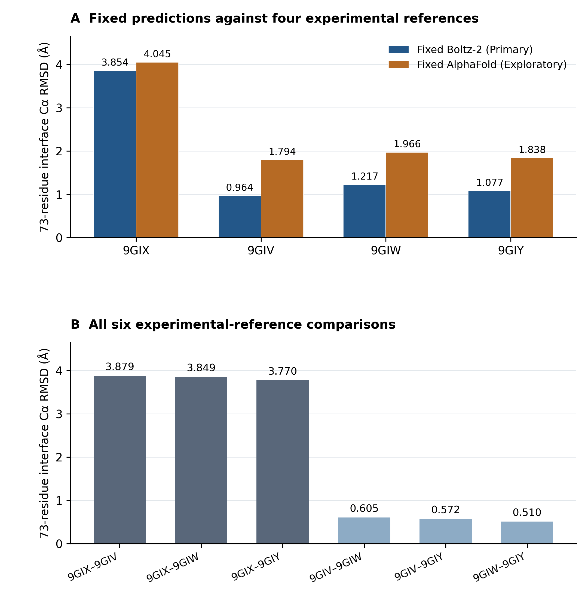

# Experimental-Reference Sensitivity of a Fixed Boltz-2 MPC1L–MPC2 Complex Prediction, with an Exploratory AlphaFold Structural Comparison

**Sho Miyazaki**  
Independent researcher, Tokyo, Japan  
Correspondence: shomiyazaki98@gmail.com  
Technical Note | Version 1.0.0 | 3 November 2026  
Zenodo version DOI: 10.5281/zenodo.23910491 (https://doi.org/10.5281/zenodo.23910491).

## Abstract

The experimental structure chosen as a reference forms part of a structural comparison. We evaluated one fixed Boltz-2 Human PPI Atlas prediction of human MPC1L–MPC2 against four cryo-EM complex structures using a common, experimentally defined 73-residue interface Cα mask and proper rigid-body alignment. The RMSD was 3.853976 Å to apo inward-open 9GIX, compared with 0.964115, 1.217374 and 1.077057 Å to inhibitor-bound outward-open 9GIV, 9GIW and 9GIY, respectively. All six experimental-reference comparisons, mask sensitivities and chain-specific fits provide context for this reference dependence. Predefined local geometry and qualified interaction-candidate screens describe additional, nonuniform structural correspondence. A separately sourced fixed AlphaFold-derived structure showed the same qualitative ordering under the common protocol. These observations describe the selected coordinates and do not establish comparative model performance or a new transport mechanism. The accompanying data, source mappings and independently checked calculations provide a limited, reusable record of how reference and evaluation conventions enter this structural comparison.

## 1. Introduction

### 1.1 Experimental background

The mitochondrial pyruvate carrier connects cytosolic pyruvate production with mitochondrial metabolism. Sichrovsky and colleagues determined human MPC1L–MPC2 heterodimer structures in inward-open and outward-open conformations by cryo-electron microscopy [1]. Their study established structural and functional evidence for transport and inhibitor binding, including an apo inward-open structure and outward-open structures bound to C7, zaprinast or mitoglitazone. These structures supply related but distinct experimental references for evaluating a fixed computational complex.

The same study also generated large AlphaFold-Multimer ensembles, varied multiple-sequence-alignment depth, and analyzed conformational relationships. Its Supplementary Figure S9 describes subunit-interface contacts in two experimental states. Thus, neither MPC conformational diversity nor the use of AlphaFold predictions and local interaction diagrams in this system originates with the present note. We use the published state labels and structural assignments as experimental context, rather than attempting to redetermine the mechanism.

### 1.2 Fixed predictions and the present question

Ille and colleagues released an atlas of 1,394 human binary interaction models generated with Boltz-2, together with confidence analyses and selected experimental comparisons [2,3]. Boltz-2 itself was introduced by Passaro and colleagues [10]. The fixed MPC2 O95563–MPC1L P0DKB6 entry, recorded as atlas row 147, is the Primary input examined here. A separately sourced AlphaFold-derived complex from the AlphaFold Protein Structure Database (AFDB), entry AF-0000000204012512 v1, provides an Exploratory comparison [4].

The Primary question is: how does structural agreement between one fixed Boltz-2 MPC1L–MPC2 prediction and four experimental complex structures vary under a common, experimentally defined interface Cα alignment protocol? Supporting analyses ask what additional context follows from predefined alignment sensitivities, interface descriptors and qualified local geometry. The Exploratory question is whether the second fixed structure shows a similar reference-dependent pattern under the same evaluation. The study units are individual saved coordinate sets and specified comparisons, rather than repeated predictions or biological replicates.

## 2. Methods

### 2.1 Structural inputs and provenance

We used the frozen Boltz-2 v2.1.1 atlas CIF, based on the Boltz-2 method [10], from repository commit dc55acabb3da7f233def7a0668d86e1c0ecb8e8e, four frozen wwPDB CIFs (9GIX, 9GIV, 9GIW, 9GIY), and the separately frozen AFDB complex CIF (Table 1). The exact atlas file was freshly matched byte-for-byte to that fixed upstream commit during production. All original CIFs are retained with SHA-256 identities and original archive-member provenance. Model inference was not rerun. The experimental structures contain auxiliary components; only the target MPC1L and MPC2 chains enter the geometric measurements. The original article and SI were inspected for state, inhibitor and prior-analysis context [1].

<!-- TABLE T1 START -->
**Table 1. Structures and conditions**

| Input | Source identifier | State | Condition | Role |
| --- | --- | --- | --- | --- |
| Boltz-2 | O95563_P0DKB6_Boltz-2_v2-1-1 | Not assigned | Protein-only fixed model | Primary A |
| 9GIX | PDB 9GIX | Inward-open | Apo | Experimental reference |
| 9GIV | PDB 9GIV | Outward-open | C7 (UK5099 derivative) | Experimental reference |
| 9GIW | PDB 9GIW | Outward-open | Zaprinast | Experimental reference |
| 9GIY | PDB 9GIY | Outward-open | Mitoglitazone | Experimental reference |
| AlphaFold | AF-0000000204012512-model_v1 | Not assigned | Protein-only fixed model | Exploratory B |

*State labels describe experimental conditions from Sichrovsky et al. [1]. No state is assigned to either prediction by this table. Boltz-2 source: Atlas row 147, version 2.1.1. AlphaFold source: AFDB/NVIDIA entry v1, AF-Multimer 2.3.0 weights.*
<!-- TABLE T1 END -->

### 2.2 Chain correspondence and common residue coverage

Protein identity and aligned sequence positions define correspondence, not a shared chain letter. In the original predictions, chain A is MPC2 and B is MPC1L; in the experimental CIFs, the target label chains are A=MPC1L and B=MPC2. The common region comprises MPC1L positions 22–105 (84 Cα sites) and MPC2 positions 8–121 (114 sites), totaling 198 sites. All six inputs cover these positions with matching amino-acid identities. Source label, author and entity identifiers are recorded separately in SI Tables S1–S2 and the complete crosswalk. Alternate conformers follow highest occupancy, then blank/lexicographic tie resolution. Original coordinate bytes remain unchanged.

### 2.3 Experimental-reference masks and proper alignment

Within the common region, an experimental residue pair enters the interface if its minimum observed interchain heavy-atom distance is strictly below 5.0 Å in at least one of the four references. The union of 107 residue pairs defines a fixed mask of 73 residues: 37 MPC1L and 36 MPC2. Predictions do not define the mask. A sensitivity union at strictly below 4.0 Å contains 69 pairs and 62 residues (30 MPC1L, 32 MPC2). Per-reference contact-pair counts and the exact residue lists are retained separately (SI Tables S3 and S3a).

For the Primary endpoint, one proper rotation and translation minimizes the squared differences of all 73 matched Cα sites across both chains. RMSD is then evaluated on those same sites, with equal site weights, no scaling and no reflection. This fixed-mask Cα endpoint is distinct from standard DockQ interface RMSD. Residue order is MPC1L followed by MPC2, ascending within each protein.

### 2.4 Primary comparisons and alignment sensitivities

The Primary roster contains four Boltz-to-experiment comparisons and all six unordered experimental-reference comparisons. For each pair, seven values were retained: the 73-, 62- and 198-site same-set fitted RMSDs; independent MPC1L and MPC2 fits; and two cross-chain evaluations, fitting one whole common chain and evaluating the other without refitting. This gives 70 values. Independent-chain fits describe within-chain correspondence, whereas cross-chain values include both internal geometry and relative arrangement. A cross-chain RMSD is not a pure translation or an isolated rigid-body chain displacement. No significance test or statistical error bar is assigned to the fixed comparisons.

### 2.5 Supporting descriptors and verification

Saved DockQ 2.1.3 outputs provide directional model/native interface descriptors, including Fnat, standard iRMSD and ligand RMSD [5]. Protein-identity normalization gives A=MPC1L and B=MPC2 in both exported inputs; the executed DockQ mapping is therefore AB:AB. FreeSASA 2.2.1 measures solvent occlusion of observed target-protein heavy atoms, using Lee–Richards, a 1.4 Å probe, 20 slices and ProtOr radii [6]. We report ΔSASA=SASA(MPC1L)+SASA(MPC2)−SASA(complex) and half-BSA=ΔSASA/2. Atom coverage differs among structures.

The H1 descriptor averages oriented local axes derived from successive four-Cα windows on either side of fixed nominated hinge positions, following a HELANAL-type construction [7,8]. Endpoint-axis removal supplies a predefined numerical sensitivity flag. H2/H3 descriptors are directed and acute angles between longer-segment PCA axes within each structure; they do not measure a between-state bundle rotation. Five predefined residue pairs per structure were assessed by Cα separation, closest observed heavy atoms and contact flags.

Interaction screens use separate evidence tiers. Tier 0 selects Lys/Arg-to-Asp/Glu functional-atom pairs strictly below 4.0 Å. Tier 1 selects chemically typed donor/acceptor heavy-atom candidates at D–A≤3.0 Å, without hydrogen placement. Conditional Tier 2 uses historical OpenMM/PDBFixer hydrogenated copies under pH 7.0, HIE histidine and amber14-all.xml assumptions; it requires D–A≤3.0 Å and D–H–A≥150°, after original-heavy preservation within 1e−5 Å. It is a model-dependent geometric screen. wwPDB entry and residue-level quality fields contextualize local experimental geometry; maps were not rerefined.

Production verification recalculated all 105 A+B RMSDs from original coordinates using an SVD fit and a separate Cα parser with a quaternion/eigenvalue fit. It also replayed deterministic contact, helix, local-pair and Tier 0/1 calculations. DockQ, FreeSASA and hydrogen-placement engines were not independently rerun: their saved outputs, arithmetic, atom/parameter records and accepted Tier 2 snapshots received narrower checks (SI S7).

### 2.6 Exploratory fixed AlphaFold comparison

The AFDB/NVIDIA CIF declares AlphaFold-Multimer v2.3.0 weights, based on the AlphaFold-Multimer method [11], with an OpenFold-TRT/cuEq pathway, paired-MSA generation and no templates. We evaluated this one fixed complex against all four experiments and directly against the fixed Boltz structure using the same seven metrics, giving 35 additional values. Its masks and definitions were inherited unchanged from A. Individual MSA content, seeds and model-selection histories are not matched between predictions; B therefore remains Exploratory.

## 3. Results

### 3.1 Fixed Boltz-2 agreement across four references

Under the common 73-residue protocol, Boltz-to-reference RMSD was highest for apo inward-open 9GIX (3.853976 Å). It was lower for all three inhibitor-bound outward-open references: 0.964115 Å for 9GIV, 1.217374 Å for 9GIW and 1.077057 Å for 9GIY (Figure 1A; Table 2). This is the Primary reference-dependent observation for the fixed Boltz coordinates.

<!-- TABLE T2 START -->
**Table 2. Principal structural comparisons**

| Comparison group | Source vs target | 73-residue RMSD (Å) |
| --- | --- | --- |
| Primary A | Boltz-2 vs 9GIX | 3.853976 |
| Primary A | Boltz-2 vs 9GIV | 0.964115 |
| Primary A | Boltz-2 vs 9GIW | 1.217374 |
| Primary A | Boltz-2 vs 9GIY | 1.077057 |
| Experimental control | 9GIX vs 9GIV | 3.879390 |
| Experimental control | 9GIX vs 9GIW | 3.848898 |
| Experimental control | 9GIX vs 9GIY | 3.769616 |
| Experimental control | 9GIV vs 9GIW | 0.605305 |
| Experimental control | 9GIV vs 9GIY | 0.572130 |
| Experimental control | 9GIW vs 9GIY | 0.510085 |
| Exploratory B | AlphaFold vs 9GIX | 4.045460 |
| Exploratory B | AlphaFold vs 9GIV | 1.794373 |
| Exploratory B | AlphaFold vs 9GIW | 1.966428 |
| Exploratory B | AlphaFold vs 9GIY | 1.837599 |

*All 14 comparisons use the same two-chain 73-Cα fit and evaluation set. Source/target direction identifies saved fits; the same-mask optimum RMSD is symmetric. These rows are not statistical replicates.*
<!-- TABLE T2 END -->

### 3.2 All six experimental-reference comparisons

The three comparisons involving 9GIX gave 3.879390 Å (9GIX–9GIV), 3.848898 Å (9GIX–9GIW) and 3.769616 Å (9GIX–9GIY). The outward-open reference pairs were closer under the same metric: 0.605305 Å (9GIV–9GIW), 0.572130 Å (9GIV–9GIY) and 0.510085 Å (9GIW–9GIY). Figure 1B and Table 2 show every comparison rather than compressing them into a statistical group average.

### 3.3 Mask and chain-alignment sensitivity

The same reference-dependent pattern persisted for Boltz under the predefined 62-site and common 198-site same-set fits (Table 3). Numerical values varied with the evaluated set, so these metrics are retained as distinct definitions rather than interchangeable accuracy estimates.

<!-- TABLE T3 START -->
**Table 3. Mask sensitivity of the fixed Boltz-2 structure**

| Reference | 73 residues (Å) | 62 residues (Å) | 198 residues (Å) |
| --- | --- | --- | --- |
| 9GIX | 3.853976 | 3.727117 | 4.478252 |
| 9GIV | 0.964115 | 0.804675 | 1.482408 |
| 9GIW | 1.217374 | 0.948745 | 1.662196 |
| 9GIY | 1.077057 | 0.872235 | 1.638168 |

*Each column is fitted and evaluated on its own indicated Cα set. Thresholds defining the masks are strictly <5 Å and <4 Å; the 198-residue set is sequence-common coverage.*
<!-- TABLE T3 END -->

For Boltz–9GIX, the independently fitted MPC1L RMSD was 0.858598 Å, while MPC2 was 4.172290 Å. Fitting MPC1L and evaluating MPC2 gave 8.303083 Å; the reverse cross-chain evaluation gave 6.251804 Å. MPC2 own-fit and cross-chain values were substantially smaller against the three outward-open references (Table 4). Thus, the 9GIX contrast includes MPC2 internal geometry as well as relative chain arrangement; it cannot be reduced to a single rigid-chain displacement.

<!-- TABLE T4 START -->
**Table 4. Chain-specific and cross-chain alignment: fixed Boltz-2**

| Reference | Fit/evaluate MPC1L (Å) | Fit/evaluate MPC2 (Å) | Fit MPC1L; evaluate MPC2 (Å) | Fit MPC2; evaluate MPC1L (Å) |
| --- | --- | --- | --- | --- |
| 9GIX | 0.858598 | 4.172290 | 8.303083 | 6.251804 |
| 9GIV | 1.189383 | 1.503577 | 1.941535 | 1.689469 |
| 9GIW | 1.469730 | 1.499637 | 2.264895 | 2.135073 |
| 9GIY | 1.260680 | 1.641993 | 2.261337 | 1.879886 |

*MPC1L: 84 Cα sites; MPC2: 114. Cross-chain evaluation applies the fitted transform without a second fit. It includes internal shape differences and relative arrangement; it is not a pure translation or a single rigid-body displacement.*
<!-- TABLE T4 END -->

### 3.4 Supporting local structural observations

H1 correspondence was nonuniform across the two proteins. The fixed Boltz MPC1L local-axis proxy was closer to the 9GIX value than to the three outward-open values, whereas its MPC2 proxy was closer to the outward-open references (SI Table S9). This local observation does not define a new mixed state. The within-structure H2/H3 acute-axis angles for Boltz were 19.932° in MPC1L and 26.301° in MPC2 (SI Table S10); the separately proposed between-state bundle-rotation endpoint was not qualified or run.

All distinct Tier 0 salt-bridge candidate pairs were MPC1L Glu51–MPC2 Lys66 in 9GIV, 9GIW and 9GIY, and MPC1L Arg56–MPC2 Asp59 in 9GIY (SI Table S12). Tier 1 yielded 21 atom-level donor/acceptor proximity candidates across eight residue-pair types (SI Table S13). These tiers describe coordinates and chemical typing under fixed screens.

The accepted Tier 2 set contained five atom triplets across three different residue-pair types: MPC1L Ser54–MPC2 Asp59 in Boltz; MPC2 Ser68–MPC1L Asp45 in Boltz, AlphaFold and 9GIV; and MPC2 Lys66–MPC1L Glu51 in 9GIV (SI Table S14). Tier 2 completed for Boltz, 9GIV and AlphaFold. It remained NOT RUN for 9GIX, 9GIW and 9GIY because the original-heavy preservation gate was exceeded. Those entries are not zero-candidate observations.

Saved Boltz DockQ scores were 0.465 against 9GIX and 0.738–0.798 against the three outward-open references. FreeSASA half-BSA values span different observed heavy-atom coverages (SI Tables S7–S8). Local atom distances and wwPDB quality fields provide context for these descriptors (SI Tables S11 and S15), without establishing affinity differences or new bonding mechanisms.

### 3.5 Exploratory AlphaFold comparison

The fixed AlphaFold-derived structure showed the same qualitative reference ordering: its 73-residue RMSDs were 4.045460 Å to 9GIX and 1.794373, 1.966428 and 1.837599 Å to 9GIV, 9GIW and 9GIY (Figure 1A; Table 2). These are descriptive comparisons of the chosen coordinates, not a controlled model ranking.

Direct AlphaFold–Boltz comparison gave 1.477727 Å on the 73-site mask and 3.198991 Å on the 198-site common set. The direct contrast is separate from the 14 experiment-related comparisons in Table 2. All five AF comparisons and 35 values, including chain fits and the corrected AF–9GIX 62-site value, are provided in SI Table S6 and the unchanged canonical CSV.

**Figure 1. Reference dependence under a common 73-residue interface Cα protocol.** (A) One fixed Boltz-2 structure (Primary) and one fixed AlphaFold-derived structure (Exploratory) compared with four experimental references. (B) All six experimental-reference comparisons. Each bar shows RMSD after a proper two-chain fit on the same 73 Cα sites; panels use the same unit and y-axis range. Labels show three-decimal display values; Table 2 and canonical CSVs retain greater precision. 9GIX is apo inward-open; 9GIV, 9GIW and 9GIY are inhibitor-bound outward-open references. Bars are individual fixed comparisons; no error bar or significance inference is implied.
<!-- PAGEBREAK -->

## 4. Discussion

### 4.1 Reference-dependent structural agreement

For this fixed Boltz prediction, a single common interface definition yields different agreement with the four experimental references. The experimental-to-experimental results demonstrate that the references themselves differ appreciably under that definition. Retaining all four comparisons therefore gives a more specific description than quoting a single RMSD without identifying the reference. The lower RMSDs to inhibitor-bound outward-open structures are an observation about this sample and protocol; the data do not isolate a conformational-state effect from inhibitor and preparation conditions.

The mask and chain fits show why one scalar cannot describe every aspect of the comparison. MPC1L own-fit agreement with 9GIX can coexist with a larger MPC2 own-fit difference and still larger cross-chain evaluation. Local H1 proxies likewise differ in their reference correspondence by protein. These observations motivate reporting evaluation conventions and local context, without assigning the prediction a mechanistic intermediate label.

### 4.2 Relationship to previous studies

Sichrovsky et al. already established the experimental states and inhibitor poses, analyzed interface interactions, and generated 100,000 MPC1L–MPC2 AlphaFold-Multimer models as part of a broader structural-modeling study [1]. The underlying AlphaFold-Multimer method was reported by Evans et al. [11]; the original Boltz-2 model was introduced by Passaro et al. [10]. Their between-state helix/bundle analysis and conformational sampling are not reproduced by the present fixed local-axis descriptors. The AFDB/NVIDIA model used here is also not a recovered member of that original ensemble. Our interaction candidates must therefore be read as protocol-specific coordinate descriptions, not newly discovered MPC chemistry.

Ille et al. supplied the fixed Boltz atlas prediction and reported atlas-wide confidence and selected experimental/AlphaFold3 comparisons [2,3]. The present common-mask comparison of one atlas entry with four MPC references does not support an atlas-wide model-performance conclusion. No independent novelty claim or independent minimum scientific contribution is established by this note. The intended output is a limited Technical Note and reusable calculation record.

### 4.3 Reproducibility and reuse value

The reproducibility package connects claims to manuscript locations, canonical full-precision CSVs, source-coordinate hashes, masks, residue correspondence and fresh verification outputs. It preserves failed qualification, unrun screens and the historical transcription correction. A reader can independently replay the fixed-coordinate RMSDs and selected deterministic descriptors using the distributed small scripts and inputs. This enables examination of the reported reference dependence without implying that prediction generation or every third-party engine can be fully reproduced from this package.

## 5. Limitations

The analysis includes one fixed Boltz prediction, one fixed Exploratory AlphaFold-derived prediction and four related experimental references. Apo/inhibitor treatment, experimental state and preparation are confounded. Neither the references nor their pairwise comparisons constitute independent biological replicates. The 73- and 62-site masks are operational experimental unions, and results depend on the fit/evaluation set; they are not universal definitions of the functional interface.

MSAs, templates, seeds, run dates, checkpoint identities and selection procedures are not controlled or fully recoverable at the individual-model level. Source metadata declarations are not independent proof of model generalization or absence of indirect information. No comparative benchmark, state population, inhibitor causality, thermodynamic binding energy or affinity difference is established. The experimental target geometry also omits auxiliary components present during structure determination, and observed heavy-atom coverage differs.

Cryo-EM local quality varies; finite-resolution side-chain coordinates and historical protonation assumptions limit atomic interaction interpretation. Tier 1 proximity and accepted Tier 2 triplets are not experimental proof of hydrogen bonding. Three experimental Tier 2 screens remain unrun. The old short-window H1 PCA failed sensitivity checks, one retained H1 estimate carries a predefined sensitivity flag, and the between-state bundle-rotation endpoint is not qualified. The supplementary record distinguishes these outcomes from numerical PASS checks.

The fresh independent verification supports deterministic coordinate calculations. DockQ, FreeSASA, OpenMM/PDBFixer and cryo-EM processing were not independently reexecuted in production. Saved-output inspection and arithmetic checks provide a shallower verification layer for those results; stochastic hydrogen-placement regeneration is not promised.

## 6. Conclusions

For the selected fixed Boltz-2 MPC1L–MPC2 structure, 73-residue interface Cα agreement was reference-dependent, with lower RMSDs to three inhibitor-bound outward-open structures than to apo inward-open 9GIX. A separately sourced fixed AlphaFold-derived structure showed the same qualitative ordering in an Exploratory comparison. The limited observation is accompanied by explicit alignment sensitivities, qualified local descriptors and a traceable computation record; it does not establish general predictor performance or a new MPC mechanism.

## Declarations

**Data and code availability.** The version 1.0.0 distribution includes this Technical Note, Supplementary Information, Figure 1, frozen input coordinates and numerical results, and executable verification/production sources. Zenodo version DOI: 10.5281/zenodo.23910491 (https://doi.org/10.5281/zenodo.23910491). Repository: https://github.com/shomiyazaki-ai/boltz2-mpc-reference-structure-comparison. The package README and reproducibility guide specify the tested commands and distinguish coordinate replay from historical third-party engine inspection. The corresponding GitHub release commit is recorded separately from the immutable repository payload to avoid self-referential checksums.

**Source provenance and licensing.** Experimental coordinates are credited to Sichrovsky et al. and wwPDB, under CC0. The atlas CIF retains its fixed-commit MIT notice. The AFDB/NVIDIA CIF and derived copies retain CC-BY-4.0 attribution and source usage conditions. Third-party papers, SI PDFs, validation-report originals, model weights and MSAs are excluded. The author has confirmed ownership/publication authority for the author-created work and approved CC BY 4.0 for original text, figures and eligible author-created data presentations, and MIT for original scripts. The stated licenses apply to author-created material in the distribution, without overriding third-party rights; exact scope and retained notices are specified in LICENSE_SCOPE and RIGHTS_MANIFEST.

**AI-assisted research disclosure.** ChatGPT assisted research planning, coding, source organization, analysis, drafting, figure/table preparation and consistency checking. Computational verification in this production is disclosed separately from historical execution. AI is not an author; the named author retains responsibility for scientific interpretation, source attribution and final release decisions.

**Funding.** No specific funding was received for this independent study.

**Competing interests.** The author declares no competing interests.

<!-- PAGEBREAK -->

## References

[1] Sichrovsky M, Lacabanne D, Ruprecht JJ, et al. Molecular basis of pyruvate transport and inhibition of the human mitochondrial pyruvate carrier. Science Advances. 2025;11:eadw1489. https://doi.org/10.1126/sciadv.adw1489. Main article, Fig. 2 and structural-modeling Methods; Supplementary Fig. S9 and Tables S1–S2 inspected.

[2] Ille AM, Markosian C, Burley SK, Pasqualini R, Arap W. An AI/ML-modeled structural atlas of the human protein interactome with functional and cancer-focused networks. bioRxiv, version 3, posted 14 March 2026. https://www.biorxiv.org/content/10.1101/2025.07.03.663068v3. Source identifier retains the 2025 DOI stem; the supplied v3 PDF was inspected.

[3] Structural Interactome. Human-interactome source repository. Fixed commit dc55acabb3da7f233def7a0668d86e1c0ecb8e8e. https://github.com/structural-interactome/human-interactome/tree/dc55acabb3da7f233def7a0668d86e1c0ecb8e8e. MPC2–MPC1L CIF and MIT license checked 3 November 2026.

[4] AlphaFold Protein Structure Database / NVIDIA collaborator complex dataset. Entry AF-0000000204012512, model v1. https://alphafold.ebi.ac.uk/entry/AF-0000000204012512. Frozen CIF is the per-entry source for software, sequence, protocol and license metadata; https://alphafold.ebi.ac.uk/faq supplies database reuse terms.

[5] Mirabello C, Wallner B. DockQ v2: improved automatic quality measure for protein multimers, nucleic acids, and small molecules. Bioinformatics. 2024;40:btae586. https://doi.org/10.1093/bioinformatics/btae586.

[6] Mitternacht S. FreeSASA: An open source C library for solvent accessible surface area calculations. F1000Research. 2016;5:189. https://doi.org/10.12688/f1000research.7931.1.

[7] Bansal M, Kumar S, Velavan R. HELANAL: A program to characterize helix geometry in proteins. Journal of Biomolecular Structure and Dynamics. 2000;17:811–819. Method reference as identified in the official MDAnalysis HELANAL documentation [8].

[8] MDAnalysis Development Team. helix_analysis, official version 2.9.0 documentation and source. https://docs.mdanalysis.org/2.9.0/_modules/MDAnalysis/analysis/helix_analysis.html. Only the mathematical local-axis definition is reimplemented in the portable replay code; no third-party package source is bundled.

[9] Worldwide Protein Data Bank. Entries 9GIX, 9GIV, 9GIW and 9GIY and linked validation reports. https://www.rcsb.org/structure/9GIX ; https://www.rcsb.org/structure/9GIV ; https://www.rcsb.org/structure/9GIW ; https://www.rcsb.org/structure/9GIY. Frozen coordinate revisions and report-derived scalar fields are identified in SI S1 and S6.

[10] Passaro S, Corso G, Wohlwend J, et al. Boltz-2: Towards Accurate and Efficient Binding Affinity Prediction. bioRxiv. 2025;2025.06.14.659707. https://doi.org/10.1101/2025.06.14.659707. Method-development source; the model was not rerun in this study.

[11] Evans R, O’Neill M, Pritzel A, et al. Protein complex prediction with AlphaFold-Multimer. bioRxiv. 2021;2021.10.04.463034. https://doi.org/10.1101/2021.10.04.463034. Method-development source; the fixed AFDB/NVIDIA complex is separately identified by its own entry and metadata.
